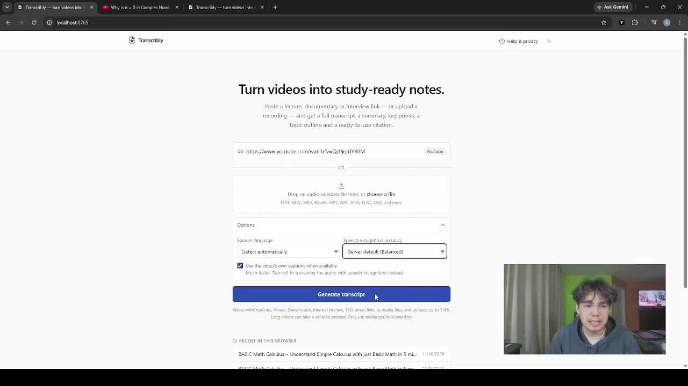

# Transcribly

Turn videos into study-ready notes. Paste a YouTube (or Vimeo, Dailymotion, TED, Internet Archive, direct media)
link or upload an audio/video file, and Transcribly gives you:

- a full, timestamped, searchable transcript (copy with or without timestamps, never truncated)
- an AI-written executive summary, key takeaways, key concepts, main conclusions and study questions, where
  **every point links to the exact passage in the transcript it came from**
- a topic outline that follows the video and jumps into the transcript
- APA 7, MLA 9, Chicago (notes-bibliography and author-date) and Harvard citations with editable details
- one complete study document as TXT, Markdown, PDF or Word (DOCX)

Everything runs on free, open-source software on your own computer. No paid account or API key is needed.

## Demo

[](docs/media/transcribly-demo.mp4)

**[▶ Watch the 5-minute demo](docs/media/transcribly-demo.mp4)** — pasting a YouTube lecture, following the
progress, reading the AI study notes, jumping from a note to the transcript passage it is based on, switching
citation styles, and exporting.

## What it does, step by step

1. **You give it a video.** Paste a link or drop in a file (MP4, MOV, MKV, WebM, MP3, WAV, M4A, FLAC, OGG…).
2. **It gets the words.** If the video already has captions, Transcribly uses them (seconds). Otherwise it
   transcribes the audio on your machine with [faster-whisper](https://github.com/SYSTRAN/faster-whisper),
   an open-source speech recognition model.
3. **An AI reads the whole transcript, then writes study notes.** By default this is Qwen 2.5 7B, an open-source
   model running locally through [Ollama](https://ollama.com). It must cite the transcript lines behind every
   statement; Transcribly then checks each citation, re-links ones that don't match, and drops statements it
   can't find support for.
4. **You study and export.** Click any timestamp in the notes to jump to and highlight that passage, copy a
   citation, or download everything as one document.

Optional: switch the notes to **Claude** (Anthropic's API) for more accurate notes. This costs a few cents per
video and sends the transcript to Anthropic, so it is off unless you turn it on (see below).

---

## Setup

You need about 5 GB of free disk space (more if you use the local AI model) and an internet connection for the
first run. Commands below are shown for **Windows (PowerShell)** and **macOS / Linux (Terminal)**.

### 1. Install the prerequisites

| Tool | Version | Where to get it | Check it works |
|---|---|---|---|
| Git | any | https://git-scm.com/downloads | `git --version` |
| Python | **3.10 – 3.13** (3.12 recommended) | https://www.python.org/downloads/ | `python --version` |
| Node.js | 20 or newer (LTS) | https://nodejs.org | `node --version` |
| Ollama *(optional, for AI notes)* | latest | https://ollama.com/download | `ollama --version` |

> Python 3.14 and newer won't work yet: faster-whisper doesn't publish packages for them.
> On Windows, tick **"Add python.exe to PATH"** in the Python installer.
> FFmpeg is installed automatically with the Python packages; you don't need to install it separately.

### 2. Download the code

```bash
git clone https://github.com/TheChadPriest/transcribly.git
cd transcribly
```

### 3. Set up the backend (Python)

**Windows (PowerShell)** — create the virtual environment on a short path, because some video libraries fail to
load from long folder paths:

```powershell
python -m venv C:\venvs\transcribly
C:\venvs\transcribly\Scripts\python.exe -m pip install --upgrade pip
C:\venvs\transcribly\Scripts\python.exe -m pip install -r backend\requirements.lock.txt
```

**macOS / Linux:**

```bash
python3 -m venv backend/.venv
backend/.venv/bin/python -m pip install --upgrade pip
backend/.venv/bin/python -m pip install -r backend/requirements.lock.txt
```

> On an **Intel Mac**, or a Mac older than macOS 14, one pinned package has no build for your system. Install
> from `backend/requirements.txt` instead of `backend/requirements.lock.txt` (same command, other file).

### 4. Build the website (Node.js)

```bash
cd frontend
npm ci
npm run build
cd ..
```

This creates `frontend/out`, which the backend serves.

### 5. Start Transcribly

**Windows (PowerShell)**, from the `transcribly` folder:

```powershell
$env:TRANSCRIBLY_FRONTEND_DIST = "$PWD\frontend\out"
C:\venvs\transcribly\Scripts\python.exe -m uvicorn app.main:app --app-dir backend --port 8000
```

**macOS / Linux**, from the `transcribly` folder:

```bash
TRANSCRIBLY_FRONTEND_DIST="$PWD/frontend/out" backend/.venv/bin/python -m uvicorn app.main:app --app-dir backend --port 8000
```

Open **http://localhost:8000** in your browser. Leave the terminal window open while you use the app; press
`Ctrl+C` there to stop it.

The first time you transcribe audio (a video without captions, or an uploaded file), Transcribly downloads the
Whisper speech model (~480 MB). Results, uploads and models are stored in a `data/` folder, which is never
uploaded to Git.

### 6. Turn on AI study notes (optional, free, runs locally)

Without this step, the app still works: the notes are assembled from the transcript's own sentences and the app
says so. For AI-written notes:

1. Install Ollama from https://ollama.com/download and start it (on Windows and macOS it runs in the background
   after installing).
2. Download the model once (about 4.7 GB):

   ```bash
   ollama pull qwen2.5:7b
   ```

3. Restart Transcribly. It finds the model automatically; the notes then say *"Written by AI … Qwen 2.5 7B"*.
   You can check at http://localhost:8000/api/health (`"ai_notes": {"available": true, …}`).

**What to expect:** the local model needs about 6 GB of free memory and is slow on a laptop without a graphics
card. Measured on a 16 GB laptop: an 8-minute video took about 13 minutes and an 11-minute video about 17 minutes,
almost all of it spent writing the notes. Closing other heavy apps (browsers, games) speeds it up noticeably. On a
weak machine, use the smaller model instead: `ollama pull qwen2.5:3b` and set
`TRANSCRIBLY_OLLAMA_MODEL=qwen2.5:3b` before starting.

Small local models write clear notes but can get facts wrong (in testing, Qwen 2.5 7B misattributed two facts in
an 11-minute history lecture). Use the timestamp links to check anything important. **If accuracy matters
(assignments, exams), use Claude.**

### 7. Use Claude instead (optional, paid)

Claude writes more accurate notes and runs an extra fact-check pass, in about 1–2 minutes. It costs roughly
$0.10–0.40 per video depending on length, billed by Anthropic, and transcripts are sent to Anthropic's API.

1. Create an API key at https://console.anthropic.com (you'll need to add billing there).
2. Set it **as an environment variable in the terminal you start Transcribly from**, together with the provider
   setting. Never paste the key into a file in this repository.

   Windows (PowerShell):

   ```powershell
   $env:ANTHROPIC_API_KEY = "paste-your-key-here"
   $env:TRANSCRIBLY_AI_PROVIDER = "claude"
   ```

   macOS / Linux:

   ```bash
   export ANTHROPIC_API_KEY="paste-your-key-here"
   export TRANSCRIBLY_AI_PROVIDER=claude
   ```

3. Start Transcribly in that same terminal (step 5).

These variables last only for that terminal window. To make them permanent, set them in your operating system's
environment variables, not in the code.

### Option: run with Docker instead

If you have [Docker](https://docs.docker.com/get-docker/) installed, steps 3–5 become one command:

```bash
docker compose up -d --build
```

Open http://localhost:8000. To add the local AI model:
`docker compose --profile ai up -d`, then `docker compose exec ollama ollama pull qwen2.5:7b`.

### Troubleshooting

| Problem | Fix |
|---|---|
| `pip install` fails building `av` or `ctranslate2` | Your Python is too new. Install Python 3.12 and recreate the virtual environment. |
| Windows: "The filename or extension is too long" | Put the virtual environment on a short path such as `C:\venvs\transcribly` (step 3). |
| A YouTube video says "could not be accessed" | Some videos are blocked from download tools by YouTube (region, age or "made for kids" limits). Transcribly doesn't bypass these; try another video or upload a file you're allowed to use. |
| Notes say they were assembled from transcript sentences | Ollama isn't running or the model isn't downloaded. Check `ollama list`, then restart Transcribly. |
| AI notes are very slow or Ollama crashes | Not enough free memory. Close other apps, or use `qwen2.5:3b`. |
| A job restarted from the beginning | The server was stopped while it was working. Keep the terminal open until jobs finish. |

More in [docs/TROUBLESHOOTING.md](docs/TROUBLESHOOTING.md).

---

## Security and privacy

- **No secrets in the repository.** Nothing in this project contains an API key, token or password. The only
  secret the app uses, the key that signs per-job access links, is generated on first start and stored in the
  local `data/` folder. `.env` files, databases, logs and downloaded media are all excluded by `.gitignore`.
- **Private by default.** Speech recognition and the local AI model run on your machine. Only the Claude option
  sends data (the transcript) to a third party, and only when you turn it on.
- **Each job is private to the browser that created it**, through a signed access key, and results are deleted
  automatically after 72 hours.
- **Safe link handling.** Links are checked so the server can't be tricked into fetching private network
  addresses (every redirect is re-checked), uploads are validated by content rather than by file name, and
  requests are rate-limited.

See [docs/PRIVACY.md](docs/PRIVACY.md).

## How it works

```
browser ──► FastAPI ──► SQLite job store ◄── worker thread(s)
 (static Next.js UI)        │                    │
                            │      validate → metadata → captions? ─┐
                            │                    │ no               │ yes
                            │      download audio only → ffmpeg 16 kHz WAV
                            │      → Whisper in 10-min checkpointed chunks
                            │      → AI reads the whole transcript → referenced study notes
                            │        (references checked against the transcript; extractive fallback)
                            └────► results + citations + exports
```

- **Captions first.** For platforms that publish captions, Transcribly uses them (creator captions, or
  auto-captions in the original language only, clearly labelled as unverified) and skips speech recognition.
- **Long media.** Audio is decoded once to a WAV on disk and transcribed in ~10-minute pieces cut at the
  quietest point near each boundary. Every piece is saved, so a restart resumes where it stopped.
- **Referenced AI notes.** The model sees the transcript as numbered lines and must cite the lines behind every
  statement. Invalid line numbers are removed, citations that don't match the statement are re-linked to the
  passage that does, and statements with no supporting passage are dropped. Long videos that don't fit the
  model's context are read part by part, with a running summary of what came before.
- **Honest output.** Low-confidence passages are underlined, notes say who wrote them, missing citation data is
  never guessed, and automatic captions are never presented as verified.

Existing results can be upgraded with **Write AI study notes** on the Overview tab
(`POST /api/jobs/{id}/notes`), which rewrites the notes without re-transcribing.

## Configuration

All settings are optional environment variables prefixed with `TRANSCRIBLY_`; see [.env.example](.env.example)
for the full list. You can also put them in a `.env` file in the folder you start Transcribly from (it is
ignored by Git), except `ANTHROPIC_API_KEY`, which must be a real environment variable.

| Variable | Default | Notes |
|---|---|---|
| `WHISPER_MODEL` | `small` | `tiny`/`base` for weak CPUs, `medium`/`large-v3` with more RAM or a GPU |
| `WORKER_CONCURRENCY` | `1` | simultaneous jobs; each `small` transcription needs ~1.2 GB RAM |
| `MAX_UPLOAD_MB` / `MAX_DURATION_SECONDS` | `1024` / `21600` | set to what your machine can handle |
| `RESULT_RETENTION_HOURS` | `72` | results are deleted automatically afterwards |
| `AI_PROVIDER` | `auto` | `auto`/`ollama` (local model), `claude` (Anthropic API, opt-in), `none` |
| `OLLAMA_MODEL` | `qwen2.5:7b` | `qwen2.5:3b` for weak machines, `qwen2.5:14b` with more RAM |
| `CLAUDE_MODEL` | `claude-opus-5-5` | used only with `AI_PROVIDER=claude` |
| `AI_FACT_CHECK` | `auto` | second checking pass; `auto` = Claude only |

Speech recognition speed (`small`, int8, 20-thread desktop CPU): a 22-minute recording took 4 min 28 s. Slower
CPUs will be several times slower. A CUDA GPU is used automatically when available.

## Tests

```bash
cd backend
python -m pip install -r requirements-dev.txt
python -m pytest                                    # 127 unit + integration tests
cd ../frontend
npm run lint && npm run typecheck && npm test       # 32 component/unit tests
npm run build && npx playwright install chromium && npm run test:e2e   # browser tests, desktop + mobile
```

Test media in `backend/tests/media` is synthesized speech with known text (`backend/scripts/make_test_media.py`).
Results of the last full run: [docs/TEST_REPORT.md](docs/TEST_REPORT.md).

## Project layout

```
backend/app/
  main.py               HTTP API + static UI
  config.py, errors.py, security.py, models.py
  sources/              URL resolution, yt-dlp/direct fetch, caption parsing
  media/audio.py        ffprobe/PyAV inspection, ffmpeg conversion, chunk planning
  transcription/        speech engine (faster-whisper), segment utilities
  ai/                   model clients (Ollama, Claude), referenced notes writer, fact-check pass
  summarization/        notes service (AI first, extractive fallback)
  citations/            style templates
  exports/              one document model -> TXT / Markdown / DOCX / PDF
  jobs/                 job service, pipeline, workers, cleanup
  storage/db.py         SQLite job store
frontend/src/
  components/           form, progress, results workspace (transcript, panels, citation, export)
  lib/                  API client, formatting, clipboard, local storage
```

## More documentation

- [Deployment guide](docs/DEPLOYMENT.md): hosting on a server, free-tier realities, separate frontend hosting
- [Privacy notice](docs/PRIVACY.md)
- [Troubleshooting](docs/TROUBLESHOOTING.md)
- [Test report](docs/TEST_REPORT.md)

## Responsible use

Only process media you are allowed to use. Transcribly does not bypass DRM, logins, private videos or other
access restrictions; it relies on what each platform makes publicly available. AI notes are a study aid, not a
substitute for the source: check important points against the linked transcript.

## License

[MIT](LICENSE)
